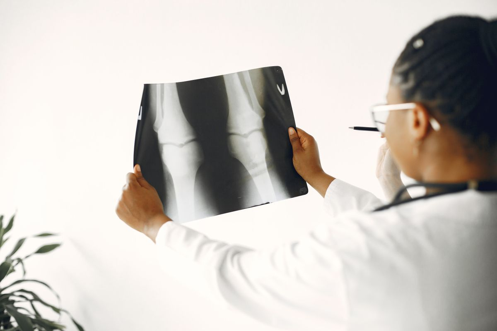
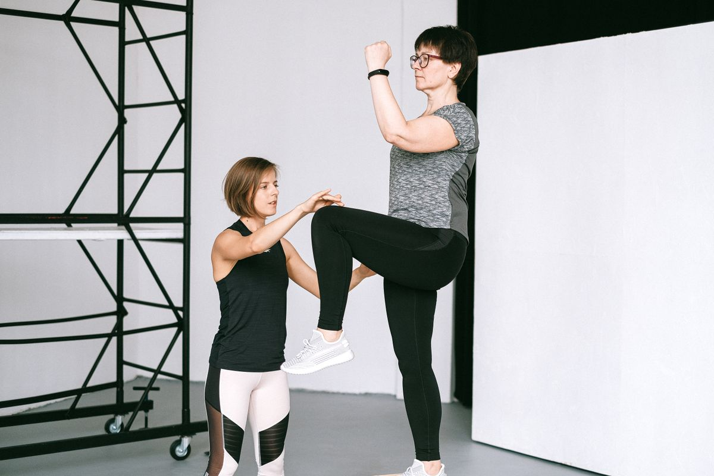
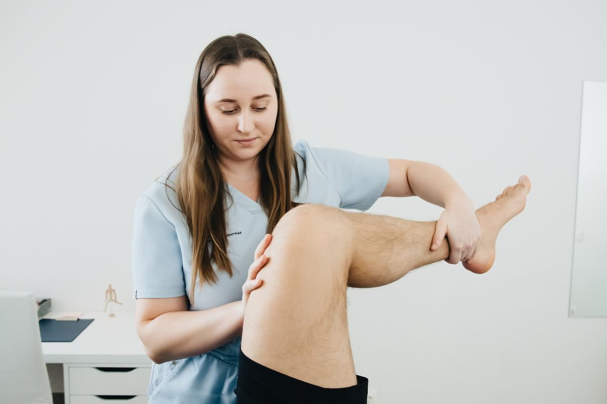
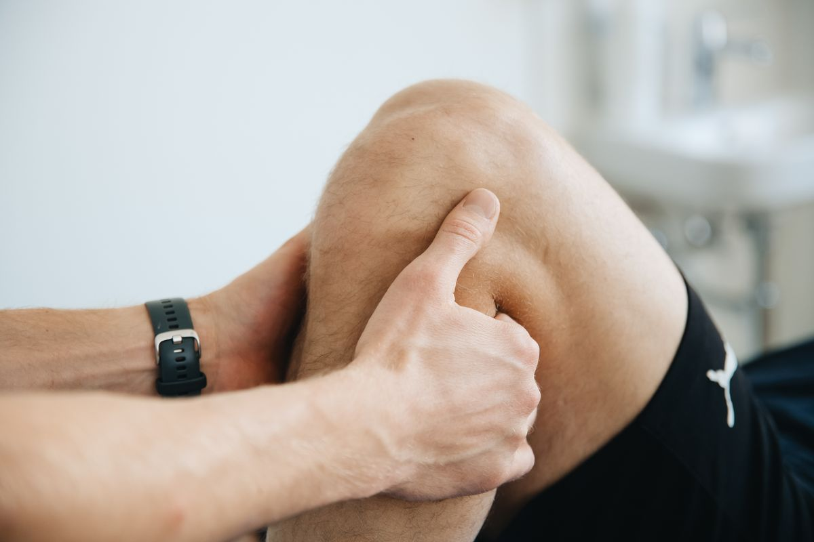
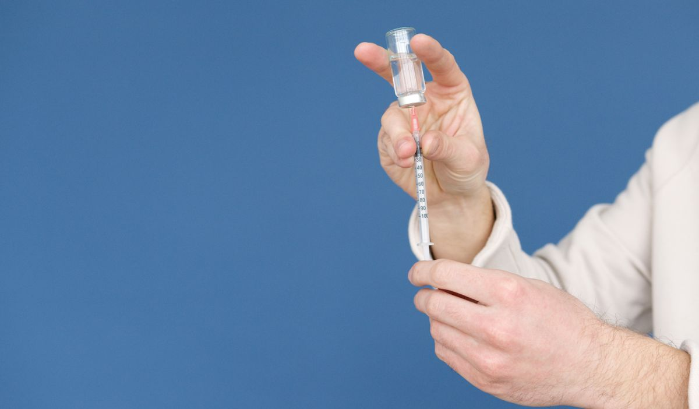
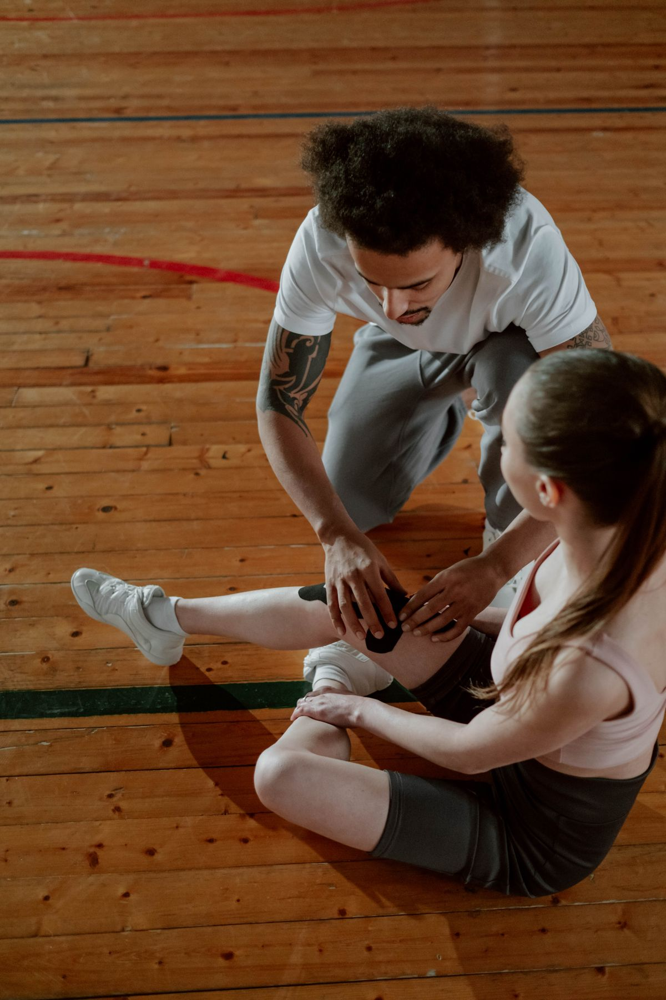
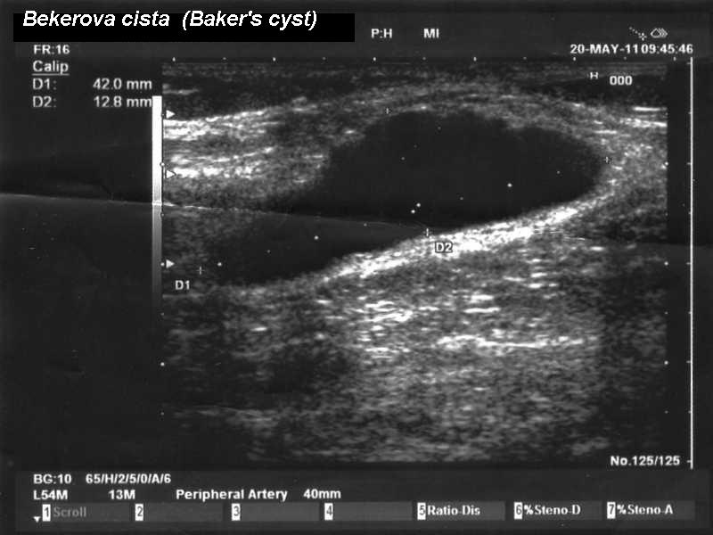
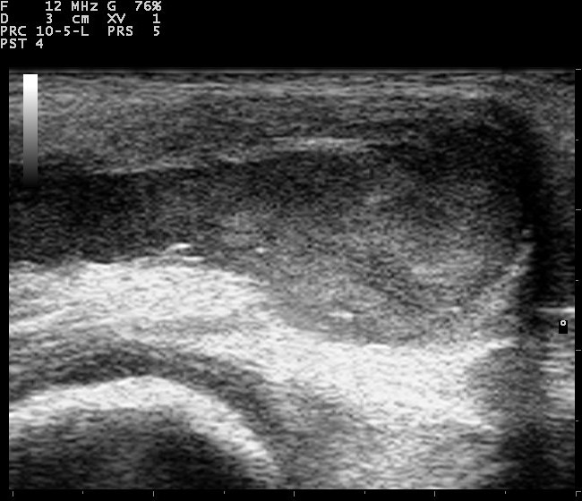

# Knee Blog Image Selections

Selected 8 September 2026. Images are saved in `public/assets/blog/`. Blog content has not been changed.

## Publishing Rules

- All photographs are illustrative stock, not Jain Pain Clinic patients, staff or outcomes. Do not imply endorsement.
- Pexels sources: https://www.pexels.com/license/ . Files downloaded at 1200 px wide using Pexels compression; original composition preserved.
- Portrait images need a deliberate layout: do not centre-crop the women or brace heroes into a short banner and lose the knee. Review mobile and desktop placement before publishing.
- Knee examination photos do not establish arthritis, a meniscal tear, swelling or a cyst in the pictured person.
- The knee X-ray illustrates imaging review, not a confirmed diagnosis or a visible meniscus tear.
- Syringe/tablet photos are conceptual. Do not identify the pictured substances as steroid, hyaluronic acid or PRP, or call them actual knee injections.
- The support content photo depicts kinesiology tape, not a knee sleeve or brace. Use in a short explanation distinguishing tape from those supports. It is not a direct sleeve-versus-brace product comparison.
- Ultrasound images below are educational examples, not clinic case records. Preserve their original dimensions and give the required visible linked attribution. Do not upscale them to hero size.

## Pexels Selections

### Knee arthritis vs meniscus tear: hero

- File: `knee-arthritis-meniscus-pain-hero.jpg`
- Source: https://www.pexels.com/photo/person-feeling-pain-in-the-knee-11349880/
- Photographer: Towfiqu barbhuiya
- Suggested alt: Person holding a painful knee while seated on a sofa.

### Knee arthritis vs meniscus tear: content

- File: `knee-arthritis-meniscus-xray-review.jpg`
- Source: https://www.pexels.com/photo/doctor-looking-at-xray-7446985/
- Photographer: Gustavo Fring
- Suggested alt: Clinician reviewing X-rays of both knees.

### Knee pain medicines: hero

- File: `knee-pain-medicines-consultation-hero.jpg`
- Source: https://www.pexels.com/photo/doctor-giving-pills-to-client-in-clinic-4021794/
- Photographer: Kaboompics
- Suggested alt: Clinician discussing tablets with a patient.

### Knee pain medicines: content

- File: `knee-pain-tablets-injections-options.jpg`
- Source: https://www.pexels.com/photo/a-medication-pills-and-injection-5994633/
- Photographer: Maksim Goncharenok
- Suggested alt: Tablets and a syringe arranged on a red background.

### Knee pain in women: hero

- File: `knee-pain-women-symptoms-hero.jpg`
- Source: https://www.pexels.com/photo/a-woman-having-a-knee-pain-7298659/
- Photographer: Kindel Media
- Suggested alt: Woman holding her knee while seated outdoors.

### Knee pain in women: content

- File: `knee-pain-women-supervised-exercise.jpg`
- Source: https://www.pexels.com/photo/a-fitness-coach-supervising-an-elderly-woman-workout-4587382/
- Photographer: Anna Shvets
- Suggested alt: Older woman practising a knee lift with a fitness coach.

### Pain behind the knee: hero

- File: `behind-knee-pain-examination-hero.jpg`
- Source: https://www.pexels.com/photo/physiotherapist-massaging-lifted-leg-20860609/
- Photographer: Funkcines Terapijos Centras
- Suggested alt: Physiotherapist supporting a bent knee and lower leg.

### Knee pain and swelling: hero

- File: `knee-swelling-examination-hero.jpg`
- Source: https://www.pexels.com/photo/physiotherapist-massaging-knee-and-leg-20860603/
- Photographer: Funkcines Terapijos Centras
- Suggested alt: Close-up of hands assessing a bent knee.

### Knee injections compared: hero

- File: `knee-injections-preparation-hero.jpg`
- Source: https://www.pexels.com/photo/a-person-holding-a-syringe-6823562/
- Photographer: Artem Podrez
- Suggested alt: Healthcare worker drawing liquid from a vial into a syringe.

### Knee injections compared: content

- File: `knee-injections-vials-equipment.jpg`
- Source: https://www.pexels.com/photo/medical-vials-over-stainless-surface-7581586/
- Photographer: cottonbro studio
- Suggested alt: Medical ampoules and syringes beside a metal tray.

### Knee cap vs knee brace: hero

- File: `knee-brace-support-hero.jpg`
- Source: https://www.pexels.com/photo/man-with-knee-brace-holding-soccer-ball-outdoors-37234920/
- Photographer: Efrem Efre
- Suggested alt: Man wearing a hinged knee brace outdoors.

### Knee cap vs knee brace: content

- File: `knee-support-taping-comparison.jpg`
- Source: https://www.pexels.com/photo/overhead-shot-of-a-man-putting-a-kinesio-tape-on-a-woman-s-injured-knee-7339493/
- Photographer: cottonbro studio
- Suggested alt: Sports trainer applying kinesiology tape around a woman's knee.

## Clinical Content Images

### Pain Behind the Knee: Content

- File: `behind-knee-pain-bakers-cyst-ultrasound.jpg`
- Source: https://commons.wikimedia.org/wiki/File:Baker%27s_cyst.jpg
- Creator: Intermedichbo.
- License: https://creativecommons.org/licenses/by-sa/3.0/
- Original: 800 x 600. Downloaded unchanged.
- Suggested alt: Ultrasound example of a Baker's cyst behind the knee with measurement markers.
- Placement: Explain how ultrasound can help assess a suspected Baker's cyst.
- Required visible credit: [Baker's cyst ultrasound by Intermedichbo](https://commons.wikimedia.org/wiki/File:Baker%27s_cyst.jpg), [CC BY-SA 3.0](https://creativecommons.org/licenses/by-sa/3.0/), unchanged. Educational example, not a Jain Pain Clinic patient.

### Knee Pain and Swelling: Content

- File: `knee-swelling-joint-effusion-ultrasound.jpg`
- Source: https://commons.wikimedia.org/wiki/File:Knee_ultrasound_110331101733_1033370.jpg
- Creator: Nevit Dilmen.
- License: https://creativecommons.org/licenses/by-sa/3.0/
- Original: 650 x 560. Downloaded unchanged.
- Suggested alt: Ultrasound example showing fluid within a knee joint.
- Placement: Explain joint effusion and why an examination or imaging may be needed to identify the cause.
- Required visible credit: [Knee joint effusion ultrasound by Nevit Dilmen](https://commons.wikimedia.org/wiki/File:Knee_ultrasound_110331101733_1033370.jpg), [CC BY-SA 3.0](https://creativecommons.org/licenses/by-sa/3.0/), unchanged. Educational example, not a Jain Pain Clinic patient.

If either CC BY-SA image is modified later, identify the modifications and license the adapted image under the applicable share-alike terms. These requirements concern the images, not an assertion that the entire blog must use that license.

